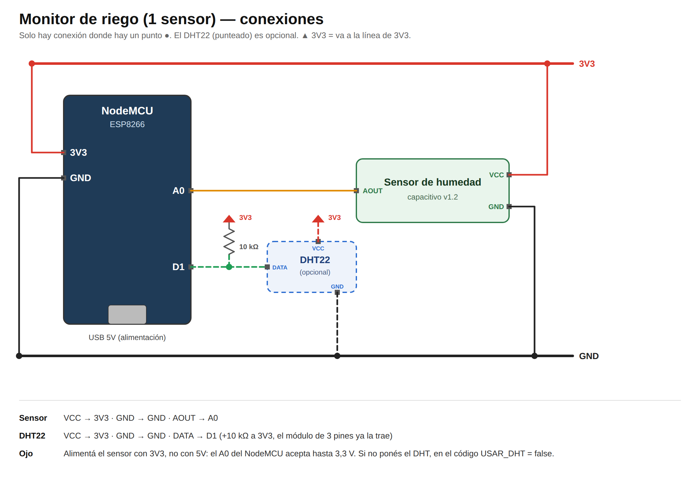

# Monitor de Riego — ESP8266 + 1 sensor de suelo (+ DHT22 opcional)

Versión simple, sin multiplexor: el sensor va directo al A0 del ESP8266.
(La versión de 8 sensores con CD4051 está en el otro repo, `monitor-riego`.)

```
[Sensor] → A0 ┐
[DHT22]  → D1 ┼→ ESP8266 ──HTTPS POST──→ Netlify Function (/api/lecturas) → Netlify Blobs
                                                        ↑
                            Web (public/index.html) ────┘ GET cada 60 s
GitHub (este repo) ──push──→ Netlify despliega solo
```

## Conexiones



| Componente | Pin | ESP8266 |
|---|---|---|
| Sensor capacitivo | VCC | 3V3 |
| | GND | GND |
| | AOUT | A0 |
| DHT22 (opcional) | VCC | 3V3 |
| | GND | GND |
| | DATA | D1 (+10 kΩ a 3V3 si es el sensor suelto) |

> Alimentá el sensor con **3V3**, no con 5V: el A0 del NodeMCU acepta hasta 3,3 V.

## Materiales
- NodeMCU v2/v3 o Wemos D1 mini
- 1 × sensor de humedad **capacitivo v1.2** (los resistivos YL-69 se corroen en semanas)
- DHT22 o DHT11 (opcional)
- Fuente 5 V (cargador de celu por USB)

## Deploy (GitHub + Netlify)
1. Subí esta carpeta a un repo nuevo de GitHub:
   ```
   git init && git add . && git commit -m "Monitor de riego 1 sensor"
   git branch -M main
   git remote add origin https://github.com/TU_USUARIO/monitor-riego-1.git
   git push -u origin main
   ```
2. Netlify: **Add new site → Import an existing project → GitHub** → elegí el repo → **Deploy** (el build lo toma de `netlify.toml`).
3. **Site configuration → Environment variables**:
   - `DEVICE_TOKEN` = una clave larga inventada (la usa el ESP para mandar datos).
   - `ADMIN_TOKEN` (opcional) = clave para cambiar nombre/umbral desde la web. Si no está, se usa `DEVICE_TOKEN`.
4. **Deploys → Trigger deploy** para que tome las variables.
5. Probá la API:
   ```
   curl -X POST https://TU-SITIO.netlify.app/api/lecturas \
     -H "X-Token: TU_TOKEN" -H "Content-Type: application/json" \
     -d '{"s1":55,"temperatura":22.5,"humedad_aire":60}'
   ```

## Firmware (`firmware/monitor_riego_1/monitor_riego_1.ino`)
1. Placa: *NodeMCU 1.0 (ESP-12E Module)* o *LOLIN(WEMOS) D1 mini*.
   Si usás DHT: librerías *DHT sensor library* y *Adafruit Unified Sensor*. Si no, poné `#define USAR_DHT false`.
2. **Calibrar**: `MODO_CALIBRACION = true`, subir, Monitor Serie a 115200.
   Anotá el valor con el sensor **al aire** → `CAL_SECO` y **en un vaso de agua** (hasta la línea) → `CAL_MOJADO`. Después volvé a `false`.
3. Completá `WIFI_SSID`, `WIFI_PASS`, `API_URL` (`https://TU-SITIO.netlify.app/api/lecturas`) y `DEVICE_TOKEN`. Subir.

## La web
- Indicador grande con el % de humedad, estado (Seco / Regar pronto / Bien / Muy húmedo) y qué hacer.
- Temperatura y humedad del aire (solo aparecen si hay DHT).
- Historial 6 h / 24 h / 7 días con la línea de umbral, y mínimo / promedio / máximo del período.
- Botón ⚙: cambiar nombre de la planta y umbral de "seco" (pide la clave una vez).
- Mobile-first, se adapta a PC (en pantalla grande el indicador queda a la izquierda y el gráfico a la derecha). Modo oscuro automático.
- Se actualiza cada 60 s. Si la abrís sin la API entra en modo demo.

## Pasar a 8 sensores después
Las funciones de Netlify y la forma de guardar los datos son las mismas; cuando tengas el CD4051 usás el otro repo (o reemplazás
`public/`, el firmware y `CAMPOS` en `lecturas.mjs`).
